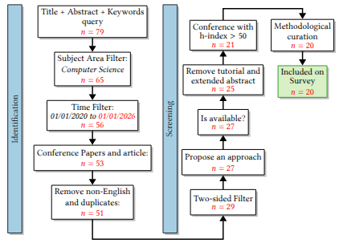

# Two-Sided Fair Recommendations

This repository contains implementations of two-sided fair recommendation methods published between January 1, 2020 and January 1, 2026. The experiments study fairness for both consumers (users) and providers/items.

<p align="center">
  
</p>

The implementations are organized into three method families:

- **Position-Agnostic Methods (PAM):** assume that every position in a recommendation list receives the same user attention.
- **Optimization-Based Methods (OBM):** model position bias by assigning different attention weights to list positions.
- **Re-Ranking methods (RR):** post-process an existing score matrix or recommendation list.
- **Matching models (MM):** allocation of agents (e.g. users) for each other with mutual preference, such as a match.

The experiments address the following research questions:

- **RQ1:** What is the impact of enforcing two-sided fairness on recommendation quality?
- **RQ2:** How can the recommendation list size impact the fairness guarantees?
- **RQ3:** Do group-fair methods attend to the underserved groups?
- **RQ4:** Are there situations in which two-sided fair recommendation approaches fail to improve fairness for one of the
stakeholder sides?

## Experiment workflow

[`experiments/grouped_experiments.py`](experiments/grouped_experiments.py) is the main experiment entry point. It consumes artifacts generated by one of the preprocessing modules:

1. `experiments.prepare_explicit_method_inputs` prepares Amazon, AMBAR, MovieLens, and Yelp.
2. `experiments.grouped_experiments` discovers the prepared runs, executes the method groups configured in `GROUPS`, and writes evaluation results as TSV files.

All commands below should be run from the repository root.

## Environment setup with uv

The project requires Python 3.12 or newer and uses [uv](https://docs.astral.sh/uv/) for Python, virtual-environment, dependency, and lockfile management.

On Debian or Ubuntu, install the native build tools and Cairo headers required by dependencies such as PyCairo:

```bash
sudo apt update
sudo apt install build-essential pkg-config libcairo2-dev
```

Install uv if it is not already available:

```bash
curl -LsSf https://astral.sh/uv/install.sh | sh
```

Then clone the repository, enter it, and synchronize the locked environment:

```bash
git clone <repository-url>
cd TwoSidedFairness-Survey
uv sync --python 3.12
```

Keep the committed `uv.lock` file: it records the resolved dependency versions. `uv sync` creates `.venv` automatically, and `uv run` executes commands in that environment, so manual activation is not required. If desired, activate it with `source .venv/bin/activate`.

Confirm that the environment is usable:

```bash
uv run python --version
uv run python -m experiments.grouped_experiments --help
```

## Data layout

By default, the explicit preprocessing module reads the following files below `data/`:

| Dataset argument | Default input file |
| --- | --- |
| `amazon` | `data/raw_datasets/explicit_feedback/Amazon/All_Beauty.json` |
| `ambar` | `data/raw_datasets/explicit_feedback/AMBAR/ratings_info.csv` |
| `movielens` | `data/raw_datasets/explicit_feedback/Movie Lens/ratings.dat` |
| `yelp` | `data/raw_datasets/explicit_feedback/Yelp/yelp_academic_dataset_review.json` |

MovieLens and AMBAR also use their accompanying user/item metadata when available. A different parent directory can be passed with `--data-root`.

The Black Friday module reads `data/raw_datasets/implicit_feedback/Black Friday/black_friday.csv` by default. Use `--source-path` to select another file with the required `User_ID`, `Product_ID`, `Gender`, `Age`, and `Purchase` columns.

### Download the datasets

The raw datasets are not committed because they exceed GitHub's file-size limit. The repository retains the required directory structure with `.gitkeep` files. Download each dataset from its original source and place the extracted files at the paths below. Review and comply with each source's license or data-use agreement before downloading.

Run the commands from the repository root. `curl`, `gzip`, and `unzip` are required for the command-line downloads.

#### AMBAR

Download the four files from the [official AMBAR repository](https://github.com/davidcontrerasaguilar/AMBAR). All four are used: ratings are the interactions, users provide consumer demographics, tracks map items to artists, and artists provide provider demographics.

```bash
curl --fail --location \
  https://raw.githubusercontent.com/davidcontrerasaguilar/AMBAR/main/data/AMBAR/ratings_info.csv \
  --output data/raw_datasets/explicit_feedback/AMBAR/ratings_info.csv
curl --fail --location \
  https://raw.githubusercontent.com/davidcontrerasaguilar/AMBAR/main/data/AMBAR/users_info.csv \
  --output data/raw_datasets/explicit_feedback/AMBAR/users_info.csv
curl --fail --location \
  https://raw.githubusercontent.com/davidcontrerasaguilar/AMBAR/main/data/AMBAR/tracks_info.csv \
  --output data/raw_datasets/explicit_feedback/AMBAR/tracks_info.csv
curl --fail --location \
  https://raw.githubusercontent.com/davidcontrerasaguilar/AMBAR/main/data/AMBAR/artists_info.csv \
  --output data/raw_datasets/explicit_feedback/AMBAR/artists_info.csv
```

#### Amazon All Beauty

Use the **All Beauty** per-category files from the [Amazon Review Data (2018) source](https://cseweb.ucsd.edu/~jmcauley/datasets/amazon_v2/index.html). `All_Beauty.json` is required for all Amazon runs. The `--amazon-brand` partition also requires `meta_All_Beauty.json`.

```bash
curl --fail --location \
  https://mcauleylab.ucsd.edu/public_datasets/data/amazon_v2/categoryFiles/All_Beauty.json.gz \
  --output data/raw_datasets/explicit_feedback/Amazon/All_Beauty.json.gz
gzip --decompress data/raw_datasets/explicit_feedback/Amazon/All_Beauty.json.gz
```

Product metadata for the brand partition:

```bash
curl --fail --location \
  https://mcauleylab.ucsd.edu/public_datasets/data/amazon_v2/metaFiles2/meta_All_Beauty.json.gz \
  --output data/raw_datasets/explicit_feedback/Amazon/meta_All_Beauty.json.gz
gzip --decompress data/raw_datasets/explicit_feedback/Amazon/meta_All_Beauty.json.gz
```

#### MovieLens 1M

Download the stable [MovieLens 1M archive](https://grouplens.org/datasets/movielens/1m/). Preprocessing uses `ratings.dat` and `users.dat`. The director-gender partition also requires `movies.dat`.

```bash
curl --fail --location \
  https://files.grouplens.org/datasets/movielens/ml-1m.zip \
  --output /tmp/ml-1m.zip
unzip -j /tmp/ml-1m.zip 'ml-1m/*' \
  -d 'data/raw_datasets/explicit_feedback/Movie Lens'
```

#### Yelp Open Dataset

The [Yelp Open Dataset](https://business.yelp.com/data/resources/open-dataset/) requires accepting Yelp's data-use terms, so it must be downloaded manually:

1. Open the official dataset page, review the terms, and select **Download JSON**.
2. Extract the downloaded TAR archive.
3. Copy the following files into `data/raw_datasets/explicit_feedback/Yelp/`:

```text
Dataset_User_Agreement.pdf
yelp_academic_dataset_business.json
yelp_academic_dataset_checkin.json
yelp_academic_dataset_review.json
yelp_academic_dataset_tip.json
yelp_academic_dataset_user.json
```

Preparation reads `yelp_academic_dataset_review.json`; it also reads
`yelp_academic_dataset_business.json` when it needs to generate a geographic
mapping. The other files are optional companion data from the official archive.

#### Black Friday

Download the [Black Friday Dataset from Kaggle](https://www.kaggle.com/datasets/aneeshamanke/black-friday-dataset). A Kaggle account may be required. After a browser download, extract `BlackFriday dataset.csv`, move it to `data/raw_datasets/implicit_feedback/Black Friday/`, and rename it to `black_friday.csv`.

Alternatively, with the [Kaggle CLI](https://github.com/Kaggle/kaggle-api) configured:

```bash
kaggle datasets download \
  --dataset aneeshamanke/black-friday-dataset \
  --unzip \
  --path 'data/raw_datasets/implicit_feedback/Black Friday'
mv 'data/raw_datasets/implicit_feedback/Black Friday/BlackFriday dataset.csv' \
  'data/raw_datasets/implicit_feedback/Black Friday/black_friday.csv'
```

After downloading all datasets, the relevant layout should be:

```text
data/raw_datasets/
├── explicit_feedback/
│   ├── AMBAR/
│   │   ├── artists_info.csv
│   │   ├── ratings_info.csv
│   │   ├── tracks_info.csv
│   │   └── users_info.csv
│   ├── Amazon/
│   │   ├── All_Beauty.json
│   │   └── meta_All_Beauty.json              # required for --amazon-brand
│   ├── Movie Lens/
│   │   ├── README
│   │   ├── movies.dat                         # required for --movielens-director-gender
│   │   ├── ratings.dat
│   │   └── users.dat
│   └── Yelp/
│       ├── Dataset_User_Agreement.pdf         # optional companion file
│       ├── yelp_academic_dataset_business.json # required to build geographic mappings
│       ├── yelp_academic_dataset_checkin.json  # optional
│       ├── yelp_academic_dataset_review.json
│       ├── yelp_academic_dataset_tip.json      # optional
│       └── yelp_academic_dataset_user.json     # optional
└── implicit_feedback/
    └── Black Friday/
        └── black_friday.csv
```

Verify the common raw data files. The [group-fairness commands](#prepare-group-fairness-inputs) list additional inputs for each partition.

```bash
test -f data/raw_datasets/explicit_feedback/AMBAR/ratings_info.csv && \
test -f data/raw_datasets/explicit_feedback/AMBAR/users_info.csv && \
test -f data/raw_datasets/explicit_feedback/AMBAR/tracks_info.csv && \
test -f data/raw_datasets/explicit_feedback/AMBAR/artists_info.csv && \
test -f data/raw_datasets/explicit_feedback/Amazon/All_Beauty.json && \
test -f 'data/raw_datasets/explicit_feedback/Movie Lens/ratings.dat' && \
test -f 'data/raw_datasets/explicit_feedback/Movie Lens/users.dat' && \
test -f data/raw_datasets/explicit_feedback/Yelp/yelp_academic_dataset_review.json && \
test -f 'data/raw_datasets/implicit_feedback/Black Friday/black_friday.csv' && \
echo 'All required raw dataset files are present.'
```

## 1. Prepare inputs

Use `--datasets` to select one or more datasets. Omitting it selects all
supported datasets and requires `--yelp-partition`. The default is 10 runs per
dataset.

Useful preprocessing options include:

- `--data-root` and `--output-root` for input and output locations.
- `--runs` and `--seed` for repetitions; run `n` uses effective seed `seed + n`.
- `--validation-ratio` and `--test-ratio` for per-user splitting.
- `--factors`, `--epochs`, `--patience`, `--batch-size`, `--learning-rate`, and `--regularization` for matrix factorization training.
- `--recommendation-list-length` for the size of top-k ranking.
- `--max-users`, `--max-items`, and `--max-dense-cells` for memory control when computational resources are limited. The filtering procedure first retained the `(max-items)` items with the largest numbers of interaction records, removed users who had interacted with fewer than three distinct retained items (to have at least one record for training, validation and test), and then retained the `(max-users)` users with the largest numbers of distinct interactions with those items.
- `--allow-missing-demographics` to skip demographic group files that cannot be constructed from real attributes.

### Prepare group-fairness inputs

Run these commands from the repository root after downloading the data. Each
command prepares one run with seed 42. The limits of 3,500 users and 3,500 items
in the AMBAR, MovieLens, and Yelp commands are upper bounds. The final run may
contain fewer users and items after filtering and splitting.

#### AMBAR consumer and artist gender

Use the four files listed under [AMBAR downloads](#ambar). Preparation writes
the track-to-artist mapping to `provider_item_mapping.csv` under
`experiments/runs/ambar/run_00/seed_42/`. At runtime, the runner uses
`users_info.csv` for consumer gender and `artists_info.csv` for provider
gender. On both sides, `F`/`female` maps to the protected group (`+1`), and
other recorded values, including `undefined`, map to the reference group
(`-1`).

```bash
uv run python -m experiments.prepare_explicit_method_inputs \
  --datasets ambar --runs 1 --seed 42 --max-users 3500 --max-items 3500
```

#### MovieLens consumer and director gender

Download MovieLens 1M and generate `Movie Lens/auxiliary_data/director_gender.csv`
using the [director mapping instructions](data/mappings/README.md#movielens-directors).
The grouped runner pairs the standard run with the director-gender run. Keep
the run count, seed, and preprocessing limits the same in both commands.

```bash
uv run python -m experiments.prepare_explicit_method_inputs \
  --datasets movielens --runs 1 --seed 42 --max-users 3500 --max-items 3500
uv run python -m experiments.prepare_explicit_method_inputs \
  --datasets movielens --movielens-director-gender \
  --runs 1 --seed 42 --max-users 3500 --max-items 3500
```

The consumer map is `data/mappings/movielens_user_gender_mapping.csv`, with
`F` mapped to `+1` and `M` to `-1`. Under
`experiments/runs/movielens/director-gender/run_00/seed_42/`,
`groups/cpfair_item_director_gender.csv` maps films with at least one woman
director to `+1` and films directed exclusively by men to `-1`. The
director-gender partition excludes films with an indeterminate classification
before splitting and has its own baseline. Each film serves as a provider
proxy.

#### Amazon consumer activity and brand demand

Place `All_Beauty.json` and `meta_All_Beauty.json` in the
[Amazon raw data directory](#amazon-all-beauty).

```bash
uv run python -m experiments.prepare_explicit_method_inputs \
  --datasets amazon --amazon-brand --allow-missing-demographics --runs 1 --seed 42
```

In `experiments/runs/amazon/brand/run_00/seed_42/`,
`groups/cpfair_user_activity.csv` splits the 20% most active consumers in
training from the remaining consumers. `provider_item_mapping.csv` maps
products to brands. `groups/provider_group_mapping.csv` assigns groups by each
brand's total training interactions across its products. By default, the top
20% of brands, rounded up, form the short head. The remaining brands form
the protected long tail. Ties are broken by normalized brand name. Each product inherits its
brand's group in `groups/cpfair_item_brand_popularity.csv`. Products without an
identifiable brand are excluded before splitting. The brand threshold is set
with `--item-popularity-top-fraction`. See the [mapping files](data/mappings/README.md#amazon-brands).

To evaluate CPFair with the matching baseline, pass the brand run directory
explicitly.

```bash
uv run python -m experiments.RQ3_groups --dataset amazon --method cpfair --k 10 \
  --run-dir experiments/runs/amazon/brand/run_00/seed_42
```

#### Yelp consumer activity and census-tract poverty

Place the Yelp reviews in the [Yelp raw data directory](#yelp-open-dataset).
To build the census mapping when a saved copy is unavailable, add the business data and
auxiliary files listed in the [census poverty mapping instructions](data/mappings/README.md#yelp-census-poverty-mapping)
and install the geographic dependencies with `uv sync --extra geographic`.

```bash
uv run python -m experiments.prepare_explicit_method_inputs \
  --datasets yelp --yelp-partition cpfair-territorial \
  --runs 1 --seed 42 --max-users 3500 --max-items 3500
```

Under `experiments/runs/yelp/cpfair-territorial/run_00/seed_42/`,
`groups/yelp_item_poverty.csv` maps US businesses with known ACS 2015–2019
census-tract poverty rates to `+1` for rates of at least 20% and `-1` for
lower rates. Each business serves as its own provider. The exported
`groups/cpfair_user_activity.csv` uses a median-based split. At runtime,
CPFair computes consumer groups from the training matrix using the 20% most
active users and the remaining users.

### Yelp metropolitan partition for TFLD-Groups

The metropolitan partition uses the 11 regions in the
[metropolitan mapping instructions](data/mappings/README.md#yelp-metropolitan-areas),
including Edmonton. Install the geographic dependencies with
`uv sync --extra geographic` to build the mapping when a saved copy is
unavailable.

```bash
uv run python -m experiments.prepare_explicit_method_inputs --datasets yelp \
  --yelp-partition tfld-metro --runs 1 --allow-missing-demographics
```

Runs are stored under `experiments/runs/yelp/tfld-metro/`. TFLD-Groups reads
`groups/yelp_item_metro.csv`. Yelp uses a separate baseline and eligible
population for each partition. Evaluate each method with the RQ3 entry point.

```bash
uv run python -m experiments.RQ3_groups --dataset yelp --method cpfair --k 10
uv run python -m experiments.RQ3_groups --dataset yelp --method tfld-groups --k 10
```

The RQ3 `group_comparison.tsv` reports per-group provider exposure totals and
means, and consumer NDCG for all, more-active and less-active users. The two
Yelp partitions have different populations; do not directly compare them as
if they were paired runs. Metro preparation requires all 11 groups after filtering.
The default `--k` in RQ3 is 150, so pass an appropriate value explicitly.

These commands apply to `experiments.RQ3_groups`. The main
`experiments.grouped_experiments` entry point does not automatically discover
the nested Yelp partition directories, and its default `GROUPS` configuration
does not include TFLD-Groups. Its generic CPFair group loader also retains
fallback paths. Do not assume that running the main entry point automatically
executes both Yelp partitions; it needs further integration for that workflow.

The local CPFair re-scores the full eligible catalog, whereas the paper describes
reranking a baseline top-N candidate list; where it uses activity-based user
groups, its split is top 20%, while the paper's experimental split is top 5%.
MovieLens and AMBAR instead use gender-based consumer groups. The local greedy
implementation also uses candidate relevance as its consumer term and binary
item exposure as its producer term; the paper describes NDCG measured on
training data as its consumer metric. These choices should be disclosed rather
than presented as an exact reproduction. The Yelp adapter masks ineligible
items for both baseline and fair rankings; it does not change the CPFair function.

See every option and its default value with:

```bash
uv run python -m experiments.prepare_explicit_method_inputs --help
```

## 2. Run the grouped experiments

With no filters, the main module discovers every directory matching `experiments/runs/*/run_*/seed_*`:

```bash
uv run python -m experiments.grouped_experiments
```

Dataset filters use the singular, repeatable `--dataset` argument. For example, run only the prepared MovieLens data and recompute top-50 baselines from its score matrices:

```bash
uv run python -m experiments.grouped_experiments \
  --dataset movielens \
  --recommendation-list-size 50 \
  --device cpu
```

Run only the implicit Black Friday artifacts with:

```bash
uv run python -m experiments.grouped_experiments \
  --dataset black_friday_implicit \
  --recommendation-list-size 50
```

To run specific prepared directories instead of discovering all runs, repeat `--run-dir`:

```bash
uv run python -m experiments.grouped_experiments \
  --run-dir experiments/runs/movielens/run_00/seed_42 \
  --results-root results/selected_runs \
  --recommendation-list-size 50
```

To store MovieLens runs elsewhere, add `--output-root artifacts/runs` to both
[MovieLens preparation commands](#movielens-consumer-and-director-gender).
Point the runner to the same root.

```bash
uv run python -m experiments.grouped_experiments \
  --runs-root artifacts/runs \
  --results-root artifacts/results
```

The runner also exposes method-specific controls, including `--ada2fair-epochs`, `--ada2fair-weight-epochs`, `--leadfairrec-semantic-weight`, `--multifr-epochs`, `--multifr-rounds`, `--multifr-batch-size`, `--ggf-epochs`, `--tfld-epochs`, `--tsfd-maxiter`, `--worse-off-fraction`, and `--multifr-positive-threshold`. Use `--device cuda` only when the synchronized PyTorch installation and machine provide CUDA support.

For the complete runner interface:

```bash
uv run python -m experiments.grouped_experiments --help
```

## Results

The default results directory is `results/`. Each configured comparison group produces a TSV file organized as:

```text
results/<fairness-definition>/<granularity>_<stakeholder>/group_<NN>.tsv
```

Each row identifies the method, dataset, seed, run, recommendation-list size, baseline and fair-method NDCG, stakeholder, granularity, and baseline/fairness metric values.

The runner preserves existing rows and appends the new rows when a target TSV already exists. Use a new `--results-root`, or archive/remove prior result files, when a clean experiment output is required.
